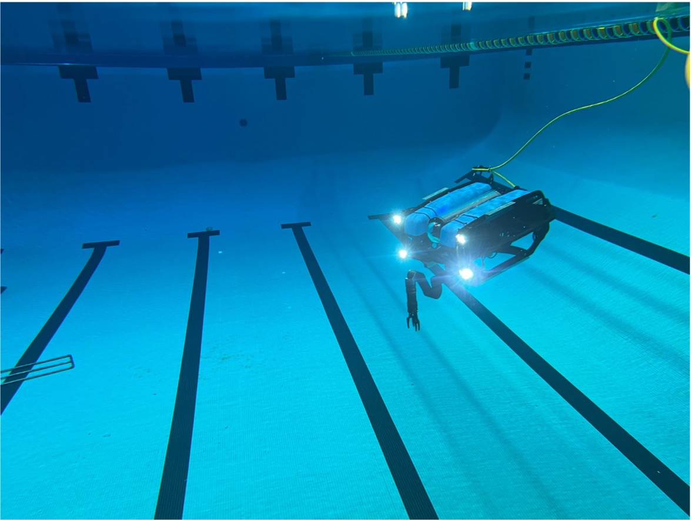
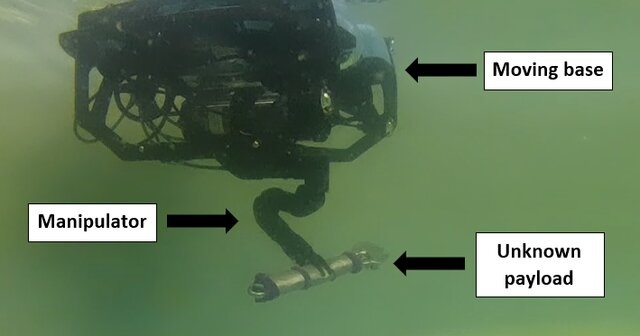

## Floating-Base Manipulator Dynamics For Underwater Robots

A toolkit for differentiable modeling of fixed- or floating-base serial manipulators.
The library ingests URDF chains and produces symbolic kinematics, dynamics, energy terms,
and identification regressors as CasADi graphs suitable for optimization, estimation,
and control.

<p align="center">
  
  
</p>

<p align="center">
  <br/>
  Sim and real comparison, left open loop prediction, right real system.
</p>

The core implementation constructs kinematic transforms, Jacobians, and Lagrangian terms
directly from URDF descriptions. All major quantities are represented as CasADi
expressions, enabling analytic derivatives and optional JIT compilation.

Low-level rigid-body and underwater vehicle dynamics utilities are provided by the
`diff_uv` library, which is included as a Git submodule. This separation keeps vehicle
and manipulator modeling modular while allowing tight symbolic integration.

The model supports payload effects, friction, and, for underwater applications,
hydrodynamic terms.

```
Floating-KinDyn-Graph/
├── baseVehicle/        # floating-base dynamics submodule (vehicle and hydrodynamics utilities) 
├── system/             # manipulator and coupling dynamics
└── usage/              # examples, notebooks, datasets
```

## Capabilities and implementation status

* [x] Forward kinematics, Euler and quaternion forms.
* [x] Jacobians, geometric, body, and analytic, base-augmented for floating base.
* [x] Forward dynamics with friction and payload terms.
* [x] Inverse dynamics, Lagrange–Euler formulation.
* [x] Energy and Lagrangian terms.
* [x] System identification regressors, Bayesian estimator, fast convex estimator.
* [x] Inverse kinematics, closed-form.
* [x] Workspace analysis via sampling (`RobotDynamics.approximate_workspace`).
* [x] EKF helpers and controller utilities.
* [x] CasADi code generation for C, C++, and MATLAB.
* [x] Optional CasADi JIT support.

## Installation

Clone the repository **with submodules**:

```bash
git clone --recurse-submodules https://github.com/edxmorgan/Floating-KinDyn-Graph.git
cd Floating-KinDyn-Graph
```

If you already cloned without submodules:

```bash
git submodule update --init --recursive
```

<!-- Create and activate a virtual environment:

```bash
python3 -m venv .venv
source .venv/bin/activate
python -m pip install --upgrade pip
```

Install Python dependencies:

```bash
pip install casadi numpy scipy matplotlib urdf-parser-py transforms3d
``` -->

## Core usage

```python
import casadi as ca
import numpy as np
import system.robot as robotSystem
import os

robot = robotSystem.RobotDynamics(use_jit=True)

project_root = os.path.abspath(os.path.join(os.getcwd(), '..'))
path_to_urdf = os.path.join(
    project_root,
    'usage',
    'urdf',
    'reach_alpha_5',
    'alpha_5_robot.urdf'
)

robot.from_file(path_to_urdf)

root = "base_link"
tip = "alpha_standard_jaws_base_link"

robot.build_model(
    root,
    tip,
    floating_base=True,
    has_endeffector=False
)

M = robot.get_inertia_matrix()
C = robot.get_coriolis_centrifugal_matrix()
G = robot.get_gravity_vector()
qdd = robot.get_forward_dynamics()
```

## System identification

The estimator is implemented in `system/system_id.py` (`SerialLinksDynamicEstimator`)
and solves a fast constrained convex fit via CVXPY (MOSEK by default).

<p align="center">
  <br/>
  Sim and real comparison, left open loop prediction, right real system.
</p>

Example workflows:

* `usage/dynamic_parameter_identification.ipynb`
* `usage/alpha_mcmc.ipynb`

Cached outputs, if generated, are stored under:

* `usage/alpha_mcmc_results_*.npz`
* `usage/posterior_alpha.bin`

### Data requirements

Identification expects CSV logs containing per-joint positions, velocities,
accelerations, and torques. Example datasets are provided under `usage/data/`.

## Controllers and observers

`system/controllers.py` provides `RobotControllers.build_arm_pid()` with feedforward
gravity compensation. Example usage is shown in `usage/controllers.ipynb`.

EKF examples are provided in `usage/joint_ekf.ipynb`.

## Workspace analysis

`RobotDynamics.approximate_workspace` samples joint limits and returns both an axis-aligned
bounding box and a point cloud.

Reference limits for the Alpha manipulator are defined in `usage/alpha_reach.py`. A
precomputed workspace sample is stored in `usage/workspace.npy`.

## References
* Edward Morgan et al., *Uncertainty-Aware Adaptive Dynamics for Underwater Vehicle Manipulator Systems*, ICRA, 2026, accepted
* Roy Featherstone, *Robot Dynamics Algorithms*, Kluwer, 1987.
* M. W. Spong, S. Hutchinson, M. Vidyasagar, *Robot Modeling and Control*, Wiley, 2006.
* Bruno Siciliano et al., *Robotics: Modelling, Planning and Control*, Springer, 2010.
## Exported endpoint IK

`usage/robot_inverse_kinematics_analysis.ipynb` defines the bounded endpoint
optimization and exports `endpoint_ik_ipopt.casadi`. SimLab loads that artifact
and the exported forward-kinematics function through its IK adapter. Solver
retries, candidate selection and final command validation belong to SimLab;
no Python runtime package from this repository is required.

### Integration rule for generated models

Keep kinematics, dynamics and estimator generation in the existing source
notebooks. SimLab and the simulator consume the exported `.casadi` functions
or compiled `.so` libraries through their existing adapters. Update the existing
export cells when fixing those models; do not add a parallel `export_*.py`
script, a source-directory import, or a new runtime Python package for them.
Retries, candidate selection, ROS integration and command validation stay in
the consuming adapter. Regenerate affected artifacts and verify their interfaces
and numerical behavior before deploying them.

Public SimLab `.casadi` artifacts are exported using stock CasADi 3.7.2 through
the existing usage notebooks. Development versions may produce incompatible
serialization. Preserve deployed function interfaces and compare outputs before
replacing artifacts. `robot_dynamics.ipynb` retains the deployed 12-parameter
per-joint `arm_id_Y.casadi` interface; the full Stribeck regressor remains available
in the notebook for analysis.

### Exported arm sliding-mode controller

`system/controllers.py::RobotControllers.sliding_mode()` builds joint-space
computed-torque sliding control. Run the existing `usage/controllers.ipynb`
from its usage directory to export `arm_sliding_mode_controller.casadi` and
`libarm_sliding_mode_controller.so` (symbol `arm_sliding_mode_control`). Use
stock CasADi 3.7.2 for portable serialized assets. Runtime consumers load these
exports; they do not import the source model package.

For `e=q_des-q`, `s=dq-dq_des-Lambda*e`, the law is

```
a = ddq_des + Lambda*(dq_des-dq) - K*s - rho*sat(s/phi)
tau_raw = M(q)*a + C(q,dq)*dq + gravity(q) + friction(dq)
tau = clip(tau_raw, effort_min, effort_max)
```

The existing variable-inertia, Coriolis, gravity, viscous, Coulomb and Stribeck
terms are used directly. When present, the fifth gripper coordinate uses the
plant's separate scalar model: `force = mass*a + damping*dq + stiffness*q`.
The gripper mass, damping and stiffness are explicit inputs, not a unit-inertia
approximation. The four revolute joints use their actual bounded joint
coordinates; angle wrapping is not applied across physical joint stops.

In the unlocked, unsaturated exact model,
`ds/dt = -K*s-rho*sat(s/phi)+inverse(M(q))*d`.
The Lyapunov function here is `s.T*s/2`, so no constant-inertia assumption or
omitted `M_dot` term is needed. Ideal sign switching (zero boundary width)
requires each `rho` to exceed the corresponding acceleration-disturbance bound.
Positive widths reduce chattering but yield practical boundary layers. The
export neither estimates that bound nor supplies hardware-validated gains.

Inputs (named): `q`, `velocity`, `desired_position`, `desired_velocity`,
`desired_acceleration`, `surface_gain`, `damping_gain`, `switching_gain`,
`boundary`, `effort_min`, `effort_max`, `parameters`; the five-coordinate version
also takes `gripper_parameters=[mass,damping,stiffness]`. The `parameters` vector
has the same order as the existing arm PID/tracking controller exports.
Outputs: clipped `effort`, unclipped `effort_raw`, `sliding`, `position_error`.

`surface_gain>0` and `damping_gain>=0` have units 1/s; `switching_gain>=0`
has units rad/s² for joints and m/s² for the gripper; `boundary>=0` has units
rad/s and m/s respectively. **These switching/damping gains are not the
vehicle export's wrench-space gains.** Outputs are Nm for joints, N for the
gripper. Callers must validate finite inputs, ordered effort limits, physically
valid inertia and positive gripper mass.

The export requests actuator effort; it does not override motor-lock hysteresis,
joint stops, or the existing command path. A locked joint can have a nonzero
requested torque, which may release it through the normal actuator logic.
Reaching/convergence guarantees do not apply while locked, at a joint stop or
under effort saturation. There is no integral state to wind up. Targets must be
reachable and respect the existing joint limits. This export alone does not add
a SimLab menu entry or switch an active controller.

IK exports in `usage/robot_inverse_kinematics_analysis.ipynb` take an explicit
`fk_path` and stage the solver/Jacobian into a new `export_dir`. They no longer
write into a hard-coded ROS workspace; install verified artifacts separately.
